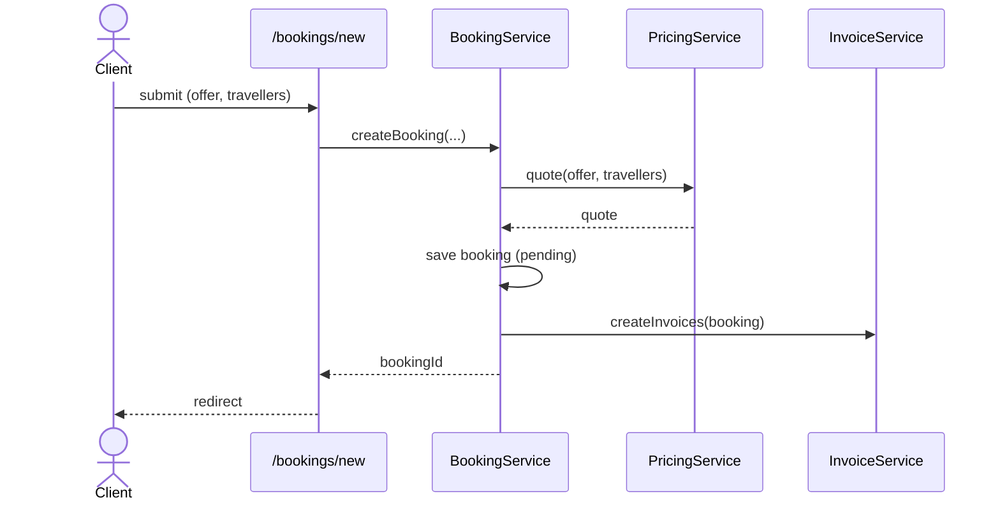
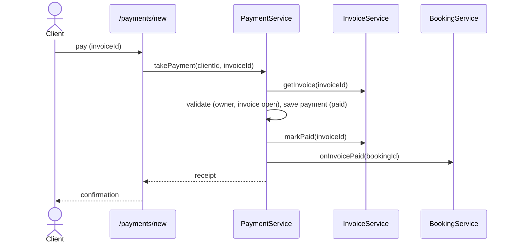
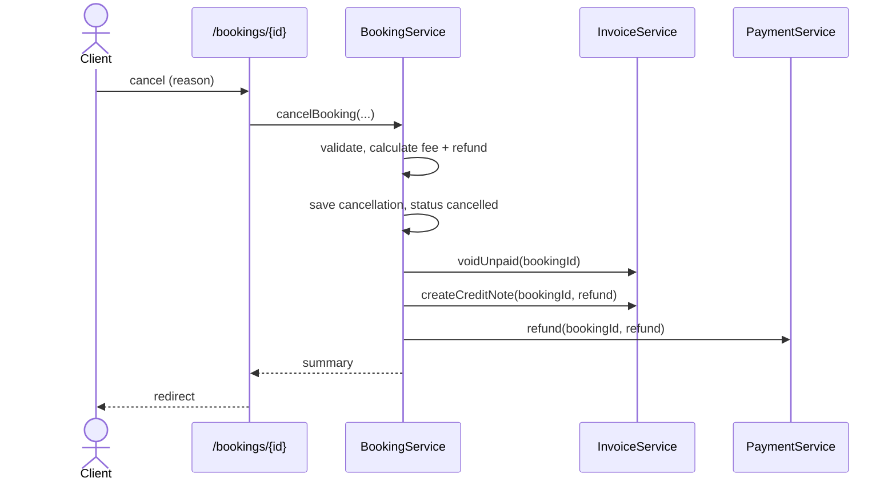
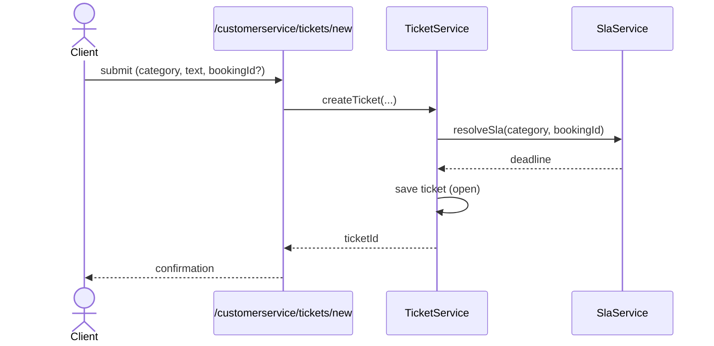

# Backend Wireframe

- Pages call one service method; services own the rules.
- Every flow checks the client owns the booking/invoice/ticket.

## Create booking

## Payment

## Cancel booking

Unpaid invoices are voided; paid amounts are refunded as a payment with status `refunded`.

## Ticket & SLA

## Service methods

| Service          | Methods                                                                                                                                            |
| ---------------- | -------------------------------------------------------------------------------------------------------------------------------------------------- |
| `BookingService` | `createBooking(clientId, tripId, travelers)` → `bookingId` `cancelBooking(clientId, bookingId, reason)` → summary `onInvoicePaid(bookingId)` |
| `PricingService` | `quote(tripId, travelers)` → quote                                                                                                                 |
| `InvoiceService` | `createInvoices(booking)` `getInvoice(invoiceId)` `markPaid(invoiceId)` `voidUnpaid(bookingId)` `createCreditNote(bookingId, amount)`  |
| `PaymentService` | `takePayment(clientId, invoiceId)` → receipt `refund(bookingId, amount)`                                                                        |
| `TicketService`  | `createTicket(clientId, category, text, bookingId?)` → `ticketId`                                                                                  |
| `SlaService`     | `resolveSla(category, bookingId?)` → deadline                                                                                                      |

`ClientService` and `TripService` aren't used in these flows.
